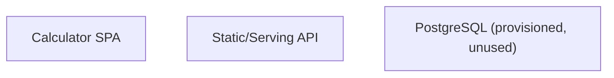
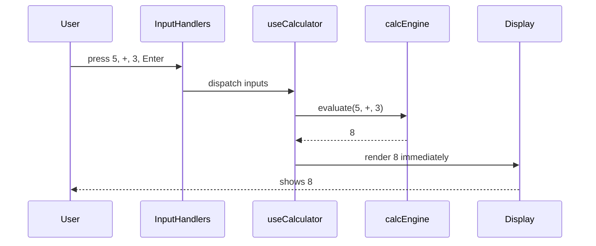
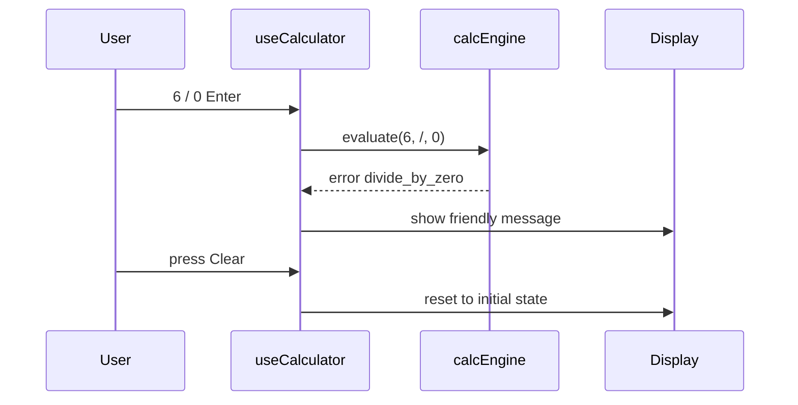
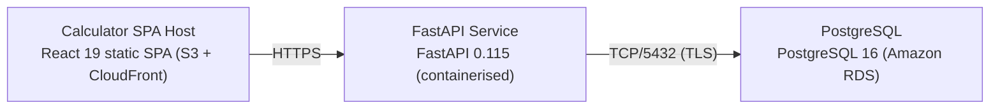

# Architecture

> Maintained by QuorQ AI SDLC. Text between `sdlc:auto` markers is regenerated; anything outside them is yours and is kept.

<!-- sdlc:auto:start narrative -->
## Overview

### ARCH-001 · approved · source: architecture:summary

Overall architecture: a client-only React 19 calculator SPA with a minimal FastAPI server layer and a provisioned-but-unused PostgreSQL database, hosted on AWS.

Simple Calculator is a single-page, browser-based calculator delivered as a React 19 SPA performing the four basic arithmetic operations on decimal numbers entirely client-side. All computation, decimal handling, clear/reset, and friendly error messaging (division-by-zero and invalid operations) happen in the browser with no data sent to or stored on a server. A minimal FastAPI 0.115 service exists only to satisfy the approved server layer and serve a health endpoint; PostgreSQL 16 is provisioned per the approved stack but sits unused as there is nothing to persist. Hosting is on AWS. There is no login, no payments, and no saved history. Status: approved, version 1.

### ARCH-COMP-WEB · approved · source: architecture:components:web_frontend

Calculator SPA (React 19) is the entire user-facing application: display, buttons, keyboard input, arithmetic, and error handling.

Single-page React app that renders the display and on-screen buttons, captures button and keyboard input, enforces single-decimal-point entry, runs all arithmetic client-side, shows immediate results, handles clear/reset and friendly error messages, and adapts layout for desktop and mobile. Keeps no history across reloads.

### ARCH-COMP-API · approved · source: architecture:components:api_backend

Static/Serving API (FastAPI 0.115) is a minimal server layer with no calculation logic.

Serves the application and exposes a health check. No calculation logic and no calculator data pass through it, since all computation is client-side.

### ARCH-COMP-DB · approved · source: architecture:components:database

PostgreSQL 16 is provisioned per the approved stack but is entirely unused in this version.

Approved relational database provisioned for future growth (e.g. saved calculations or accounts). No tables are used by this version because nothing is persisted, consistent with US-015 (no saved history).

**Related:** US-015

### ARCH-PATH-CALC · approved · source: architecture:critical_paths:Perform a calculation

Describes the end-to-end flow of entering operands and an operator and getting an immediate client-side result.

User enters a first operand, selects an operator, enters a second operand (decimals allowed, single decimal point enforced), then requests the result via the equals button or Enter key. The arithmetic runs in-browser and the result displays immediately without any network call or reload.

### ARCH-PATH-ERROR · approved · source: architecture:critical_paths:Division-by-zero and invalid-operation handling

Describes how the app handles division by zero and invalid/incomplete expressions without crashing.

When the user divides by zero or submits an incomplete/invalid expression (two operators in a row, no operands), the engine returns a friendly error state instead of throwing. The display shows the message, the app stays usable, and clear/reset returns it to the initial state.

### ARCH-EP-HEALTH · approved · source: architecture:endpoints:GET /health

A liveness/health check endpoint for the serving layer; carries no calculator data.

GET /health returns a simple status for the FastAPI serving layer. No calculation logic or calculator data passes through this or any other endpoint, since all computation is client-side.

### ARCH-DEPLOY-SPA · approved · source: architecture:deployment_nodes:Calculator SPA Host

The React SPA is deployed as static assets served via CDN.

Calculator SPA Host: React 19 static SPA served from S3 + CloudFront; static assets served over CDN.

### ARCH-DEPLOY-API · approved · source: architecture:deployment_nodes:FastAPI Service

The FastAPI service runs containerised on AWS compute.

FastAPI Service: FastAPI 0.115, containerised, running Python 3.12 on AWS (ECS Fargate or small EC2).

### ARCH-DEPLOY-DB · approved · source: architecture:deployment_nodes:PostgreSQL

PostgreSQL runs as a managed relational database on AWS RDS, though it holds no application data in this version.

PostgreSQL 16 on Amazon RDS; a managed relational database node, provisioned but unused since nothing is persisted.

**Related:** US-015

### ARCH-TECH-FRONTEND · approved · source: architecture:technology_decisions:Frontend

React 19 was chosen for the frontend over Vue and Svelte.

The entire product lives in the browser: on-screen buttons, keyboard input, decimal entry, and an instantly updating display. React 19 drives this single-page, responsive UI from one codebase for desktop and mobile, and hosts all arithmetic and error handling client-side with no reloads. Alternatives considered: Vue, Svelte.

### ARCH-TECH-BACKEND · approved · source: architecture:technology_decisions:Backend

FastAPI 0.115 was chosen as a thin server layer over Flask and Express.

No server-side calculation is required, so FastAPI 0.115 serves only as the thin server layer with a health endpoint. It is the lightest sensible choice given there is nothing for it to compute. Alternatives considered: Flask, Express.

### ARCH-TECH-DB · approved · source: architecture:technology_decisions:Database

PostgreSQL 16 was chosen as a safe-default future-proofing database over MySQL and SQLite, despite storing no data today.

The app persists nothing and keeps no history (per NFR-001 and US-015), so PostgreSQL 16 is provisioned as the safe default should saved calculations or accounts be added later; for now it stores no application data. Alternatives considered: MySQL, SQLite.

**Related:** US-015

### ARCH-TECH-CLOUD · approved · source: architecture:technology_decisions:Cloud

AWS was chosen for hosting over Azure and GCP.

A free, anonymous public calculator needs cheap, reliable hosting that scales to casual traffic. AWS hosts the static-feeling SPA via S3/CloudFront at very low cost with room to grow. Alternatives considered: Azure, GCP.
<!-- sdlc:auto:end narrative -->

<!-- sdlc:auto:start building-blocks -->
## Building Block View

| ID | Name | Technology | Responsibility | Depends on |
|---|---|---|---|---|
| web_frontend | Calculator SPA | React 19 | Single-page React app: renders the display and on-screen buttons, captures button and keyboard input, enforces single-decimal-point entry, runs all arithmetic client-side, shows immediate results, handles clear/reset and friendly error messages, and adapts layout for desktop and mobile. Keeps no history across reloads. | — |
| api_backend | Static/Serving API | FastAPI 0.115 | Minimal server layer that serves the application and exposes a health check. No calculation logic and no calculator data pass through it, since all computation is client-side. | — |
| database | PostgreSQL (provisioned, unused) | PostgreSQL 16 | Approved relational database provisioned for future growth (e.g. saved calculations or accounts). No tables are used by this version because nothing is persisted. | — |

<!-- sdlc:auto:end building-blocks -->

<!-- sdlc:auto:start runtime -->
## Runtime View

### Perform a calculation

User enters a first operand, selects an operator, enters a second operand (decimals allowed, single decimal point enforced), then requests the result via equals button or Enter key. The arithmetic runs in-browser and the result displays immediately without any network call or reload.

- **Components:** web_frontend
- **Modules:** CalculatorApp, useCalculator (state hook), calcEngine, InputHandlers (buttons + keyboard), Display
- **Key functions:** appendDigit(digit), appendDecimal(), setOperator(op), evaluate(firstOperand, operator, secondOperand), formatResult(value)

### Division-by-zero and invalid-operation handling

When the user divides by zero or submits an incomplete/invalid expression (two operators in a row, no operands), the engine returns a friendly error state instead of throwing. The display shows the message, the app stays usable, and clear/reset returns it to the initial state.

- **Components:** web_frontend
- **Modules:** useCalculator (state hook), calcEngine, Display, ClearControl
- **Key functions:** evaluate(firstOperand, operator, secondOperand), toFriendlyError(code), clearAll()

<!-- sdlc:auto:end runtime -->

<!-- sdlc:auto:start deployment-view -->
## Deployment View

| Name | Service | Runtime | Scaling | Environment |
|---|---|---|---|---|
| Calculator SPA Host | React 19 static SPA (S3 + CloudFront) | Static assets served over CDN | CDN edge caching, scales to casual public traffic | dev |
| FastAPI Service | FastAPI 0.115 (containerised) | Python 3.12 on AWS (ECS Fargate or small EC2) | Single small instance; minimal load as it only serves health | dev |
| PostgreSQL | PostgreSQL 16 (Amazon RDS) | Managed relational database | Smallest instance; provisioned but unused | dev |

| Source | Target | Protocol |
|---|---|---|
| Calculator SPA Host | FastAPI Service | HTTPS |
| FastAPI Service | PostgreSQL | TCP/5432 (TLS) |

<!-- sdlc:auto:end deployment-view -->

<!-- sdlc:auto:start decisions -->
## Architecture Decisions

| Layer | Choice | ADR |
|---|---|---|
| Frontend | React 19 | [ADR-0001](adr/frontend.md) |
| Backend | FastAPI 0.115 | [ADR-0002](adr/backend.md) |
| Database | PostgreSQL 16 | [ADR-0003](adr/database.md) |
| Cloud | AWS | [ADR-0004](adr/cloud.md) |
<!-- sdlc:auto:end decisions -->

<!-- sdlc:auto:start links -->
## Related Documents

- [Data Model](data-model.md)
- [API Specification](api/openapi.yaml)
- [Architecture Decision Records](adr/README.md)
<!-- sdlc:auto:end links -->
