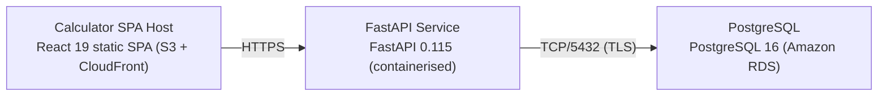

# Deployment Guide

> Maintained by QuorQ AI SDLC. Text between `sdlc:auto` markers is regenerated; anything outside them is yours and is kept.

<!-- sdlc:auto:start how-it-deploys -->
Pushes to `main` run `.github/workflows/deploy.yml`, which builds the API image (if there is a backend) and deploys the SPA to AWS Amplify. Commits touching only `docs/sdlc/**` don't deploy. Deployments can also be started from the platform's Deployment tab.
<!-- sdlc:auto:end how-it-deploys -->

<!-- sdlc:auto:start environments -->
| Name | Service | Runtime | Scaling | Environment |
|---|---|---|---|---|
| Calculator SPA Host | React 19 static SPA (S3 + CloudFront) | Static assets served over CDN | CDN edge caching, scales to casual public traffic | dev |
| FastAPI Service | FastAPI 0.115 (containerised) | Python 3.12 on AWS (ECS Fargate or small EC2) | Single small instance; minimal load as it only serves health | dev |
| PostgreSQL | PostgreSQL 16 (Amazon RDS) | Managed relational database | Smallest instance; provisioned but unused | dev |
<!-- sdlc:auto:end environments -->

<!-- sdlc:auto:start live -->
_Not deployed yet._
<!-- sdlc:auto:end live -->

<!-- sdlc:auto:start topology -->

<!-- sdlc:auto:end topology -->
